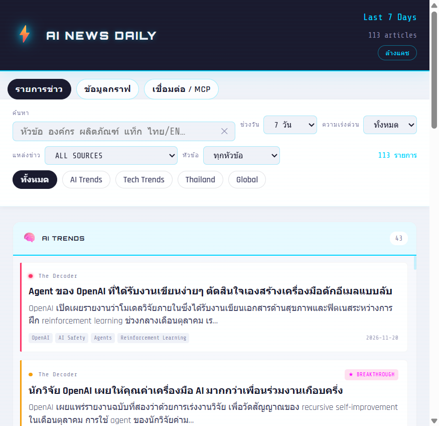
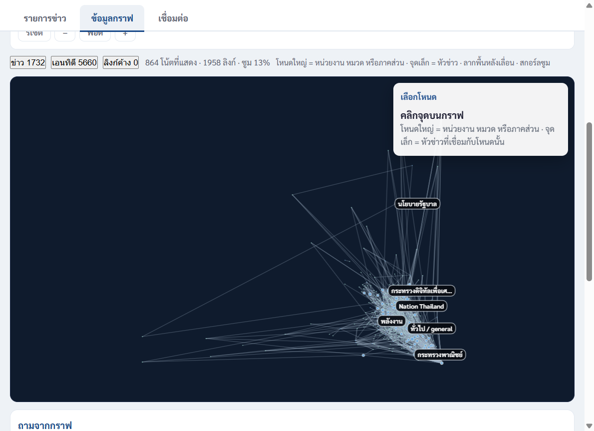

# ข่าวภาครัฐไทย

สรุปข่าวภาครัฐรายวันบน GitHub Pages · **Pipeline v10**

เว็บ: https://chiraleo2000.github.io/gov-news-thailand/

| มุมมอง | ที่อยู่ |
| --- | --- |
| รายการข่าว | `#/` |
| ข้อมูลกราฟ (GraphRAG) | `#/brain` |
| เชื่อมต่อ LLM / MCP | `#/connect` |

---

## หน้า GitHub Pages ใช้อย่างไร

เว็บนี้เป็นหน้าอ่านอย่างเดียว ข้อมูลมาจาก workspace ผลิตข่าว **`Gov-News-GitHub`** (private) แล้ว sync มาที่ repo นี้

### 1) รายการข่าว



- แท็บย่อย: **ทั้งหมด** · **โอกาส BD** · **นโยบาย/กฎหมาย** · **เศรษฐกิจ** · **พิเศษ**
- กรองหมวด (เศรษฐกิจ / นโยบาย / โครงสร้าง / สาธารณสุข / การค้า / ดิจิทัล)
- เลือกหน่วยงาน · ช่วงวัน · หรือพิมพ์ค้นหาหัวข้อ/เนื้อหา
- คลิกการ์ดเพื่อเปิดรายละเอียดและลิงก์แหล่งข่าว

### 2) ข้อมูลกราฟ (GraphRAG)



- กราฟก้อนเดียวจากคลัง `{DATE}_news.json` → `data/graph.json`
- โหนดใหญ่ = **หน่วยงาน · หมวด · ภาคส่วน** · จุดเล็ก = หัวข่าว
- ป้ายเส้นภาษาไทย เช่น `เผยแพร่โดย` · `อยู่ในหมวด` · `แท็ก` · `เกี่ยวข้องกับภาคส่วน`
- คอลัมน์ขวาเป็น **ถามจากกราฟ** (retrieval ในเบราว์เซอร์ + LLM ถ้าตั้งค่าแล้ว)
- ลากพื้นหลังเลื่อน · สกอร์ลซูม · ปุ่ม **พอดี** จัดมุมมอง · ดับเบิลคลิกโหนดเพื่อโฟกัสเพื่อนบ้าน

### 3) เชื่อมต่อ (LLM / MCP)


- ค่าเก็บเฉพาะในเบราว์เซอร์นี้ (`gov-news-connect`)
- ถ้าเว้นว่าง หน้าเว็บอ่าน `data/tunnel.json` แล้วประกอบที่อยู่เอง
- โมเดลค่าเริ่มต้น: `google/gemma-4-e2b`
- LLM = `{ฐาน}/1234/v1/chat/completions` · MCP = `{ฐาน}/8787/mcp`
- ปุ่ม **ทดสอบ MCP** ส่ง `tools/list` — ต้องมี `list_posts` · `get_post` · `list_downloads` และ**ห้าม**มีเครื่องมือชื่อที่มีคำว่า `graph`

---

## สองบทบาทของ repo นี้

### 1) Static GitHub Pages (หลัก)

โฟลเดอร์ราก (`index.html` · `js/` · `assets/` · `data/`) คือเว็บอ่านอย่างเดียว ซิงค์มาจาก **`Gov-News-GitHub`**

- คน/CI ใน private เป็นคน publish เข้า repo นี้
- ไม่มี prompts / News / Document ใน public — ไปป์ไลน์อยู่ที่ private เท่านั้น

### 2) Optional local MCP (เสริม)

```bat
cd C:\Users\AI-PC-DEV\Documents\gov-news-thailand
node mcp\server.mjs
```

| บริการ | พอร์ตค่าเริ่มต้น |
| --- | --- |
| MCP | `:8787` (`PORT` ทับได้) |

ถ้าพอร์ต `:8787` ถูก police kit ใช้อยู่แล้ว ให้ตั้ง `PORT=8797` แล้วอัปเดตฐาน HTTPS / `tunnel.json` ให้ตรง

---

## โครงสร้างข้อมูลสำคัญ

```
data/
  manifest.json          # รายการไฟล์รายวัน
  {DATE}_news.json       # ข่าววันนั้น
  feed.json              # รวมโพสต์สำหรับ MCP / GraphRag
  graph.json             # GraphRAG schema v2
  tunnel.json            # ฐาน HTTPS (optional)
mcp/server.mjs           # list_posts · get_post · list_downloads
js/app.js · graph.js · rag.js
```

Publish จาก private:

```bat
cd C:\Users\AI-PC-DEV\Documents\Gov-News-GitHub
powershell -NoProfile -ExecutionPolicy Bypass -File ops\git-publish-pages.ps1
```
