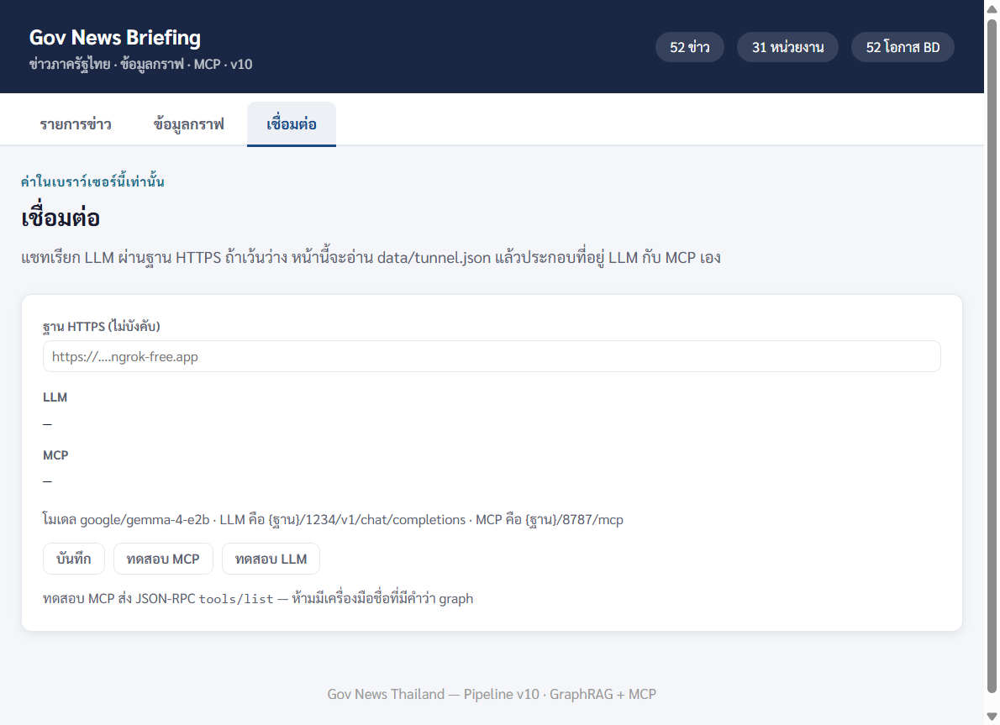

# ข่าวภาครัฐไทย

สรุปข่าวภาครัฐรายวันบน GitHub Pages · **Pipeline v10**

เว็บ: https://chiraleo2000.github.io/gov-news-thailand/

| มุมมอง | ที่อยู่ |
| --- | --- |
| รายการข่าว | `#/` |
| ข้อมูลกราฟ (GraphRAG) | `#/brain` |
| เชื่อมต่อ LLM / MCP | `#/connect` |

---

## หน้า GitHub Pages ใช้อย่างไร

เว็บนี้เป็นหน้าอ่านอย่างเดียว ข้อมูลมาจาก workspace ผลิตข่าว **`Gov-News-GitHub`** (private) แล้ว sync มาที่ repo นี้

### 1) รายการข่าว


- แท็บย่อย: **ทั้งหมด** · **โอกาส BD** · **นโยบาย/กฎหมาย** · **เศรษฐกิจ** · **พิเศษ**
- กรองหมวด (เศรษฐกิจ / นโยบาย / โครงสร้าง / สาธารณสุข / การค้า / ดิจิทัล)
- เลือกหน่วยงาน · ช่วงวัน · หรือพิมพ์ค้นหาหัวข้อ/เนื้อหา
- คลิกการ์ดเพื่อเปิดรายละเอียดและลิงก์แหล่งข่าว

### 2) ข้อมูลกราฟ (GraphRAG)


- กราฟก้อนเดียวจากคลัง `{DATE}_news.json` → `data/graph.json`
- โหนดใหญ่ = **หน่วยงาน · หมวด · ภาคส่วน** · จุดเล็ก = หัวข่าว
- ป้ายเส้นภาษาไทย เช่น `เผยแพร่โดย` · `อยู่ในหมวด` · `แท็ก` · `เกี่ยวข้องกับภาคส่วน`
- คอลัมน์ขวาเป็น **ถามจากกราฟ** (retrieval ในเบราว์เซอร์ + LLM ถ้าตั้งค่าแล้ว)
- ลากพื้นหลังเลื่อน · สกอร์ลซูม · ปุ่ม **พอดี** จัดมุมมอง · ดับเบิลคลิกโหนดเพื่อโฟกัสเพื่อนบ้าน

### 3) เชื่อมต่อ (LM Studio + MCP ข่าว)



แยกบทบาทให้ชัด:

| ช่อง | ทำอะไร | ไม่ใช่ |
| --- | --- | --- |
| **MCP** (`…/8788/mcp`) | เครื่องมือเข้าถึงคลังข่าว `list_posts` · `get_post` · `list_downloads` | ไม่ใช่แชท |
| **LLM** (`…/1234/…`) | LM Studio เล่าคำตอบในแท็บข้อมูลกราฟ หลังค้นหลักฐานในเบราว์เซอร์ | ไม่ใช่ MCP |

- ค่าเก็บเฉพาะในเบราว์เซอร์นี้ หรืออ่านจาก `data/tunnel.json`
- ใช้**อุโมงค์ RAG ร่วมเครื่อง**กับ police kit (`ai-pc-dev-rag.ngrok-free.app`) + LM Studio ที่รันอยู่แล้ว
- โมเดลค่าเริ่มต้น: `google/gemma-4-e2b`
- ทดสอบ MCP ต้องเจอเครื่องมือข่าวเท่านั้น — **ห้าม**มีชื่อที่มีคำว่า `graph`

---

## สองบทบาทของ repo นี้

### 1) Static GitHub Pages (หลัก)

โฟลเดอร์ราก (`index.html` · `js/` · `assets/` · `data/`) คือเว็บอ่านอย่างเดียว ซิงค์มาจาก **`Gov-News-GitHub`**

### 2) Local MCP ข่าว (เสริม — ไม่ใช่แชท)

```bat
cd C:\Users\AI-PC-DEV\Documents\Gov-News-GitHub
powershell -NoProfile -ExecutionPolicy Bypass -File ops\wake-gov-mcp.ps1
```

| บริการ | พอร์ต |
| --- | --- |
| Gov MCP (ข่าว) | `:8788` |
| LM Studio (แชร์) | `:1234` |
| Gateway (แชร์) | `:8790` → HTTPS |

Police crime MCP อยู่คนละพอร์ต (`:8787`) — ไม่ทับกัน

---

## โครงสร้างข้อมูลสำคัญ

```
data/
  manifest.json          # รายการไฟล์รายวัน
  {DATE}_news.json       # ข่าววันนั้น
  feed.json              # รวมโพสต์สำหรับ MCP / GraphRag
  graph.json             # GraphRAG schema v2
  tunnel.json            # ฐาน HTTPS (optional)
mcp/server.mjs           # list_posts · get_post · list_downloads
js/app.js · graph.js · rag.js
```

Publish จาก private:

```bat
cd C:\Users\AI-PC-DEV\Documents\Gov-News-GitHub
powershell -NoProfile -ExecutionPolicy Bypass -File ops\git-publish-pages.ps1
```
