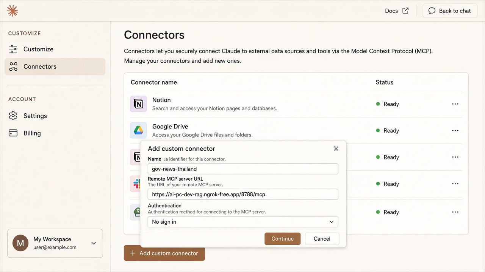
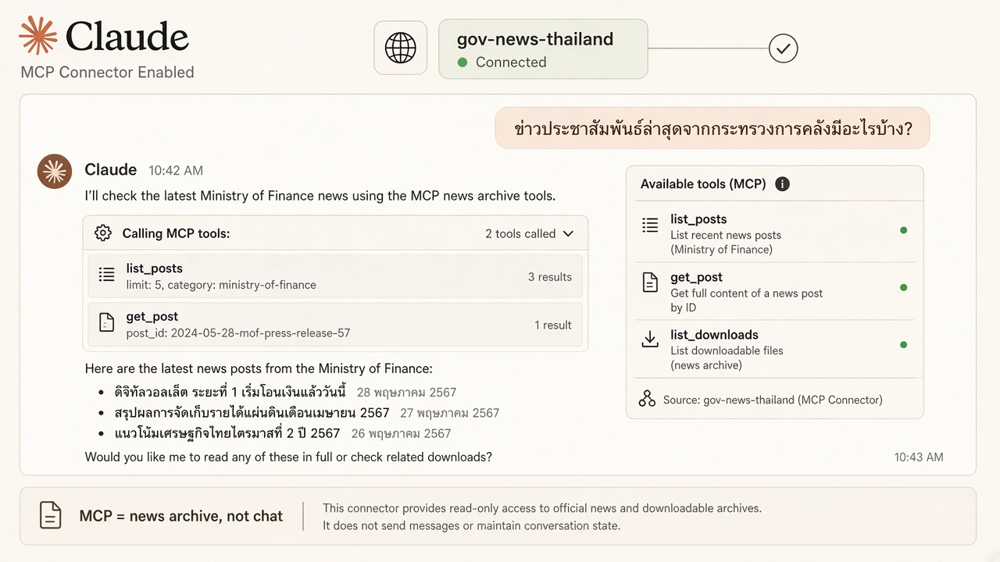

# เชื่อม Gov News MCP กับ Claude Connector

MCP ของโปรเจกต์นี้เป็น **คลังข่าว** ให้ Claude ดึงโพสต์ที่เก็บไว้ — **ไม่ใช่แชท**  
การเล่าคำตอบ GraphRAG บนเว็บใช้ LM Studio คนละช่อง (`:1234`)

| รายการ | ค่า |
| --- | --- |
| Remote MCP URL | `https://ai-pc-dev-rag.ngrok-free.app/8788/mcp` |
| เครื่องมือ | `list_posts` · `get_post` · `list_downloads` |
| Authentication | **No sign in** (เซิร์ฟเวอร์นี้ไม่ใช้ OAuth) |
| พอร์ตท้องถิ่น | `127.0.0.1:8788` (ผ่าน gateway/ngrok เป็น HTTPS :443) |

ก่อนเชื่อม: รัน `ops\wake-gov-mcp.ps1` ใน `Gov-News-GitHub` และให้อุโมงค์ police RAG (`ai-pc-dev-rag`) เปิดอยู่

### ค่าที่กรอกใน Claude (อย่าสลับพอร์ต)

| ช่อง | **gov-news-thailand** | AI-news-thailand |
| --- | --- | --- |
| **Name** | `gov-news-thailand` | `AI-news-thailand` |
| **URL** | `https://ai-pc-dev-rag.ngrok-free.app/8788/mcp` | `https://ai-pc-dev-rag.ngrok-free.app/8789/mcp` |
| **Auth** | `No sign in` | `No sign in` |

> สอง connector คนละ URL — **ห้าม**ใส่ `:8788` ให้ AI News  
> gov = **`:8788`** · AI = **`:8789`** · police = `:8787` · LLM chat = `:1234`

---

## A) Claude.ai / Claude Desktop — Custom Connector (แนะนำ)

อ้างอิงขั้นตอนทางการ: [Custom connectors using remote MCP](https://support.claude.com/en/articles/11175166-get-started-with-custom-connectors-using-remote-mcp)

1. เปิด **Customize → Connectors**
2. กด **+ Add** → **Add custom connector**
3. ตั้งชื่อ `gov-news-thailand`
4. วาง URL ทั้งเส้นรวมพาธ: `https://ai-pc-dev-rag.ngrok-free.app/8788/mcp`
5. Authentication เลือก **No sign in**
6. บันทึก แล้วกด **Connect** ให้สถานะเป็น Connected  
   (ถ้าต้องการ AI News ด้วย ให้เพิ่ม connector ที่สองชื่อ `AI-news-thailand` ที่ URL `…/8789/mcp`)



### ใช้งานในแชท

เปิด connector `gov-news-thailand` ในแชท แล้วสั่งเป็นภาษาไทย เช่น:

- «ใช้ MCP รายชื่อข่าววันนี้ที่เกี่ยวกับกระทรวงการคลัง»
- «ดึง `get_post` ของ id ที่ได้จาก `list_posts`»

Claude ควรเรียกเครื่องมือคลังข่าวเท่านั้น — ไม่ใช่แชทโมเดลของ MCP



### ข้อจำกัดเครือข่าย

- Claude เชื่อมจากคลาวด์ Anthropic ไปยัง URL สาธารณะ (ต้องเป็น **HTTPS พอร์ต 443**)
- URL แบบ `https://host:8443/mcp` หรือ `http://127.0.0.1:8788/mcp` **ใช้กับ Custom Connector ไม่ได้**
- ถ้า ngrok หลับ/หมดอายุ ให้รัน wake ของ police + `wake-gov-mcp.ps1` แล้วลอง Connect ใหม่

---

## B) Claude Desktop — Local MCP (stdio / คำสั่งเครื่อง)

ถ้าใช้เซิร์ฟเวอร์บนเครื่องโดยตรง (ไม่ผ่าน Claude.ai cloud) ใส่ใน `claude_desktop_config.json`:

```json
{
  "mcpServers": {
    "gov-news-thailand": {
      "command": "node",
      "args": [
        "C:\\Users\\AI-PC-DEV\\Documents\\gov-news-thailand\\mcp\\server.mjs"
      ],
      "env": {
        "PORT": "8788",
        "PAGES_BASE": "https://chiraleo2000.github.io/gov-news-thailand"
      }
    }
  }
}
```

หมายเหตุ: `server.mjs` โหมดปัจจุบันเป็น **HTTP MCP** บนพอร์ตที่กำหนด — สำหรับ Desktop ที่ต้องการ stdio แยก ควรใช้ Custom Connector แบบ Remote (หัวข้อ A) กับ URL อุโมงค์แทน เพราะ Claude cloud เรียก HTTPS ได้ตรง ๆ

ทางเลือก Remote ใน Desktop config (ถ้าไคลเอนต์รองรับ URL):

```json
{
  "mcpServers": {
    "gov-news-thailand": {
      "url": "https://ai-pc-dev-rag.ngrok-free.app/8788/mcp"
    }
  }
}
```

---

## C) ทดสอบก่อนใส่ Claude

```powershell
# บนเครื่อง
$body = '{"jsonrpc":"2.0","id":1,"method":"tools/list"}'
Invoke-RestMethod -Uri "http://127.0.0.1:8788/mcp" -Method POST -ContentType "application/json" -Body $body

# ผ่านอุโมงค์ (สิ่งที่ Claude เห็น)
Invoke-RestMethod -Uri "https://ai-pc-dev-rag.ngrok-free.app/8788/mcp" -Method POST -ContentType "application/json" -Body $body -Headers @{ "ngrok-skip-browser-warning" = "true" }
```

ต้องได้ชื่อเครื่องมือเท่านี้เท่านั้น: `list_posts`, `get_post`, `list_downloads`  
ถ้ามีชื่อที่มีคำว่า `graph` แปลว่าชี้ผิดพอร์ต (police MCP อยู่ `:8787`)

ตัวอย่างเรียกข่าว:

```json
{
  "jsonrpc": "2.0",
  "id": 2,
  "method": "tools/call",
  "params": {
    "name": "list_posts",
    "arguments": { "q": "การคลัง", "limit": 5 }
  }
}
```

---

## แยกจาก LM Studio

| ช่อง | ใช้ทำอะไร | URL / พอร์ต |
| --- | --- | --- |
| **MCP** | Claude / agent ดึงคลังข่าว | `…/8788/mcp` |
| **LLM** | หน้า `#/brain` เล่าคำตอบหลังค้นกราฟในเบราว์เซอร์ | `…/1234/v1/chat/completions` |

อย่าใส่ URL ของ LLM ลงใน Claude Connector — Connector ต้องการ MCP tools ไม่ใช่ OpenAI chat completions
